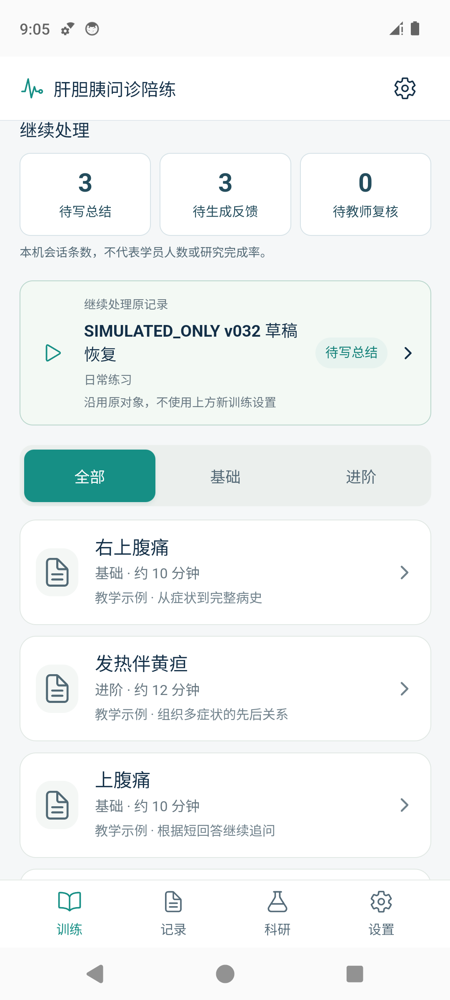
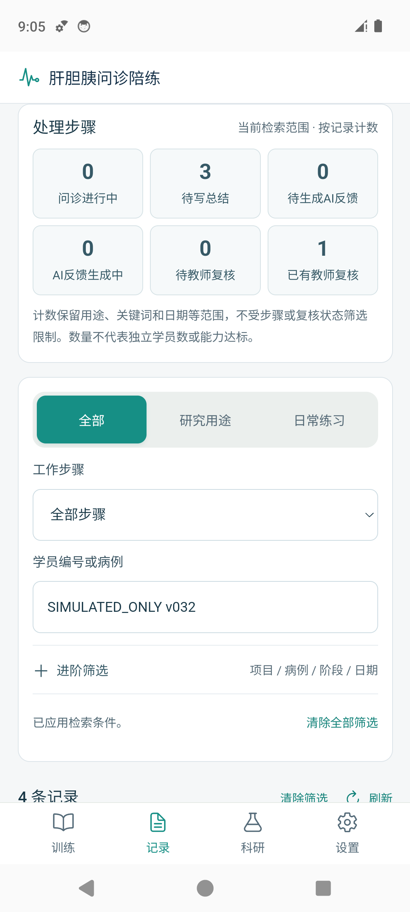
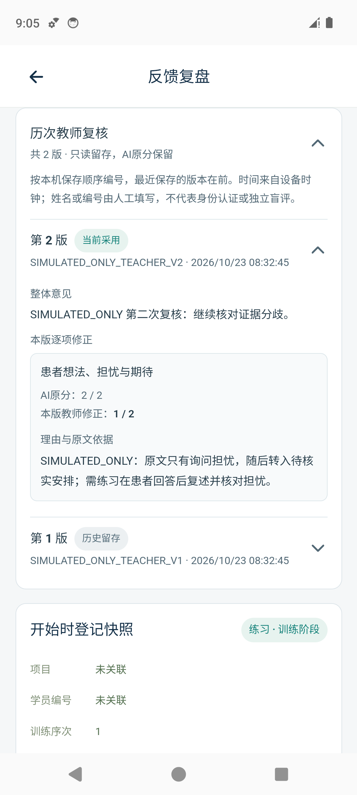

# 肝胆胰问诊陪练 · HPB Interview Trainer

[](LICENSE)

面向肝胆胰外科住培的 Android 问诊训练原型。学员与虚构患者进行语音或文字问诊，独立提交总结，再结合原文、AI反馈和教师复核回顾自己的提问。

**当前预发布：v0.3.2-alpha.1，App 版本 0.3.2 / code 6。** 手机直接连接所选 API，记录保存在本机，日常使用无需启动电脑服务。

[下载 Android 调试 APK](https://github.com/Sway479/hpb-interview-trainer/releases/download/v0.3.2-alpha.1/hpb-interview-trainer-v0.3.2-alpha.1-debug.apk) · [本版更新](docs/VERSION_0_3_2.md) · [用户指南](docs/USER_GUIDE.md) · [验证状态](docs/OPEN_SOURCE_STATUS.md)

## 可以做什么

- **问诊练习**：四个虚构病例，覆盖右上腹痛、发热伴黄疸、上腹痛、无痛性黄疸。支持语音或文字、转录回看、静音、打断与重连。
- **独立总结**：填写病史、初步判断、计划与不确定之处；草稿自动保存，有保存失败和离开页面提示。提交后锁定，供后续反馈与复核使用。
- **按需生成反馈**：在“设置 → 评分设置”中，分别选择日常练习和研究用途的手动或自动生成方式。自动模式也可先只保存总结。
- **教师逐项复核**：填写修正分、原文依据和整体意见；AI原分与历次教师复核分别保留，可查看修订历史。
- **读懂结果、安排练习**：结果说明从已有反馈和教师复核中整理优先练习任务，引用可跳到问诊原文。整理说明在本机完成，不额外请求模型、不重新评分。
- **查找未完成记录**：首页显示待写总结、待生成反馈、待教师复核；记录页可按用途、项目、病例、训练阶段、日期及复核状态检索。
- **登记与导出**：科研工作区分为概览、学员、采集准备和数据。开始训练时固定登记与模型快照；安卓可导出 CSV、精确 JSON、结果说明和可选录音，另存已取得的异常原文供恢复核对。

API Key 由手机原生凭证存储保护。训练资料保存在本机，没有自动云同步；导出 ZIP 未加密，应存入受控位置。演示和软件测试资料均为 **SIMULATED_ONLY**。

## 界面预览

以下为本版 Android 14 模拟器中的实际 APK 截图，编号与记录均为虚构测试资料。

| 训练与待办 | 记录检索 | 教师复核历史 |
| --- | --- | --- |
|  |  |  |

## 安装与开始

从 [v0.3.2-alpha.1 发布页](https://github.com/Sway479/hpb-interview-trainer/releases/tag/v0.3.2-alpha.1)下载 APK 和校验文件。安装包为 debug 调试预发布，包名 `edu.hpb.interview`，不含 API Key。

1. 打开底部 **设置 → 连接设置**，在“服务商管理”添加配置，填写该接口对应的 Key。
2. 在“本次模型”分别选择病例与反馈模型、实时语音模型，也可选择仅使用文字问诊；保存用途选择。
3. 到 **评分设置** 确认反馈生成方式。首次默认日常练习自动生成、研究用途手动生成。
4. 选择病例，核对用途与学员绑定，开始问诊；结束后独立填写并提交总结。
5. 按本次设置生成反馈，查看原文和结果说明，需要时填写教师复核。

**连接检测、问诊及AI反馈生成会访问所选服务商，可能产生 API 费用。** 本机登记、回看旧记录、手动保存总结、教师复核和整理已有结果说明可离线完成。完整操作见[用户指南](docs/USER_GUIDE.md)。

已有记录的手机请先导出并核对备份，再进行同包名、兼容签名的覆盖更新。卸载或清除数据会影响本机资料；签名冲突时应保留原 App 和记录，先核对安装包。

## 模型配置范围

| 提供商 | 已实现 | 已有验证范围 |
| --- | --- | --- |
| Qwen | 兼容文本接口、千问实时语音协议 | 指定配置有历史真实 API 联调记录；本版离线 QA 和本次发布未重新调用模型 |
| OpenAI | Chat Completions、OpenAI Realtime 适配 | 已有协议和模拟测试，真实账号仍需分别联调 |
| DeepSeek | 兼容文本接口 | 用于文本病例回答和反馈，当前不提供实时语音；真实 Key 待验收 |
| 自定义 | 已实现的文本格式及所选实时协议 | 需逐一匹配端点、模型、音色和账号权限 |

默认文字模型为 `qwen3.8-flash`，语音模型为 `qwen-audio-3.1-realtime-plus`。默认域名 `maas.qianwenaiapi.com` 是项目配置的**第三方兼容入口**。使用前请确认接口运营方，使用该入口对应的 Key。修改服务商或接口域名后，需要重新填写对应 Key。可用模型、音色与费用以所选服务商为准。

问诊文本和音频发送至所选服务商；项目与学员登记保存在本机，业务请求不主动附加这些登记。请仅使用虚构病例，避免输入真实患者身份资料。

## 验证情况与已知问题

2026-10-23 已有的 v0.3.2 验收记录包括 **181 项离线测试、16 项安装包检查、48 项专用模拟器检查**，并核对了 11 张截图及更新前后 14 个既有资料文件的哈希。本次 GitHub 发布使用该已验证 APK，**没有重跑 npm、Gradle 或模型 API**。详情见[本版更新](docs/VERSION_0_3_2.md)和[版本状态](docs/OPEN_SOURCE_STATUS.md)。

自动预评仍有**给分偏高、漏用跨轮次证据**的问题。当前量规按病例信息采集和语言沟通过程分别报告参考分与覆盖率，无百分制总分或合格线。使用时应结合原文与教师判断，见[评分抽查](docs/ASSESSMENT_SPOTCHECK.md)。

本版完成的是离线软件和模拟器验证。物理手机的新版本安装、麦克风与外放、蓝牙、后台/来电及院内网络还需现场检查；评分效度、独立考核与教学效果需另行研究。教师标识目前由使用者人工填写，没有医院身份认证。

## 从源码开发

需要 Node.js ≥22.12（建议 24）、npm；Android 构建另需 JDK 21、Android SDK 36 / Build Tools 36.0.0。依赖版本和 integrity 固定在 lockfile 中。

```bash
npm ci
npm run typecheck
npm test
npm run build
npm run dev -w @hpb/mobile
```

浏览器预览为 `http://127.0.0.1:5173`，可演练登记和旧记录；Key、原生网络、语音与 ZIP 分享需在 Android 中使用。

```bash
export ANDROID_HOME="$HOME/Library/Android/sdk"
export JAVA_HOME="$(/usr/libexec/java_home -v 21)"
bash tools/build-android.sh
```

Windows 入口为 `tools/build-android.ps1`。完整说明见[开发指南](docs/DEVELOPMENT.md)、[macOS 工具链](docs/MACOS_DEVELOPMENT.md)。`server/` 是保留的可选 v0.1 HTTP/WebSocket/MCP 网关；见 [Legacy API](docs/API_LEGACY.md)。

## 开源范围与许可证

项目原创代码与随附原创文档采用 [MIT](LICENSE)。第三方依赖保留各自许可证，见 [NOTICE](NOTICE)、[第三方声明](THIRD_PARTY_NOTICES.md)和[上游来源](docs/UPSTREAM.md)。API 服务不随源码提供。

此公开仓库保留独立的公开历史，来源和同步范围见[发布来源](docs/PUBLICATION_PROVENANCE.md)。原开发历史与验收档案另行保留。申报书、官方通知、参考模板、下载的评分来源原件、凭证、签名私钥和原始科研导出不在公开范围内。

欢迎通过 [Issues](https://github.com/Sway479/hpb-interview-trainer/issues) 报告问题，复现资料请使用虚构数据。贡献约定见 [CONTRIBUTING](CONTRIBUTING.md)。
