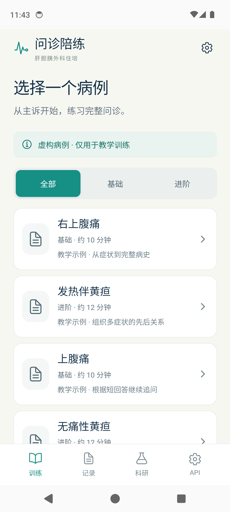
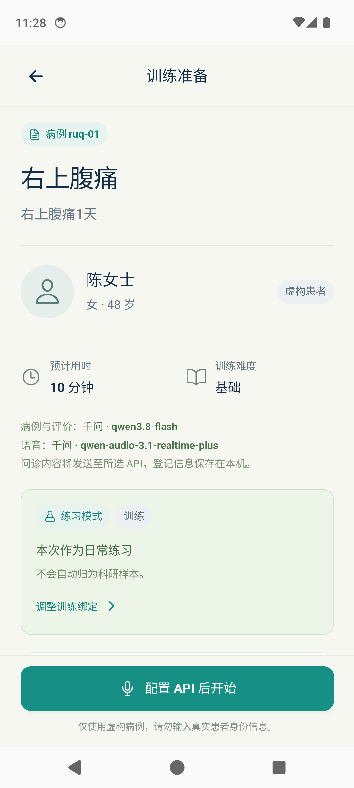
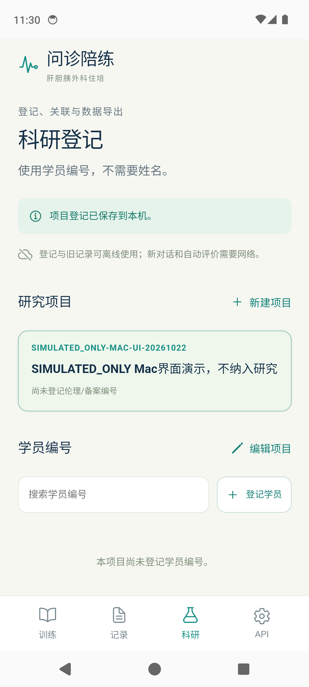

# 肝胆胰问诊陪练 · HPB Interview Trainer

[](LICENSE)

面向肝胆胰外科住培的 Android 虚构患者问诊训练原型。学员先问诊、独立提交总结，再查看带原文引用的形成性反馈。

**v0.2 安卓手机直接连接所选 API，在本机保存记录。日常使用无需启动电脑服务。当前为预发布教学原型，评分效度和教学效果尚未验证。**

## 当前功能

- 四个虚构病例：右上腹痛、发热伴黄疸、上腹痛、无痛性黄疸。
- 语音或文字问诊，转录、静音、打断、重连、独立总结与反馈复盘。
- 多套 API 配置，分别选择文字病例/反馈和实时语音；Key 在手机原生存储中由 AndroidKeyStore 保护。
- 科研项目和匿名学员编号登记，冻结会话快照，保留原始模型预评及独立教师备注。
- 原生 ZIP 导出：9 个 CSV、精确 JSON 备份、清单和可选录音；JSON 恢复支持去重和冲突拒绝，不恢复 Key 或 WAV。

没有自动云同步、医院身份认证或教师逐项改分编辑器。导出的 ZIP 未加密。所有演示和测试资料均为 **SIMULATED_ONLY**，不是患者或研究受试者数据。

## 界面预览

以下为 Android 14 模拟器中的实际 APK 截图；科研编号为虚构测试编号。

| 训练首页 | 病例准备 | 科研登记 |
| --- | --- | --- |
|  |  |  |

## 安装与使用

预发布 APK 下载见 [Releases](https://github.com/Sway479/hpb-interview-trainer/releases)。它是 debug 调试包，包名 `edu.hpb.interview`，App 内版本 `0.2.1`；不代表生产安全或真实手机声学验收通过。安装包不带 API Key，需要自行配置服务商账号。

1. 打开底部 **API**，添加配置并输入对应服务商 Key。
2. 分别选择病例与评价模型、实时语音模型；也可仅使用文字问诊。
3. 按需检测连接。**检测、问诊和反馈可能产生所选服务商的 API 费用。**
4. 选择病例 → 问诊 → 结束 → 独立总结 → 提交 → 反馈复盘。
5. 需要科研登记时先登记项目/学员，并在每次开始前核对用途、时间点及绑定卡片。

完整步骤见 [用户指南](docs/USER_GUIDE.md)。已有记录的设备请先导出备份，再核对签名兼容性；不要通过卸载来解决签名冲突。

## 模型配置范围

| 提供商 | 已实现 | 验证边界 |
| --- | --- | --- |
| Qwen | 兼容文本接口、千问实时语音协议 | 指定配置有历史真实 API 联调记录；本次开源发布没有重新调用模型 |
| OpenAI | Chat Completions、OpenAI Realtime 适配 | 协议/模拟测试，不等于真实账号联调通过 |
| DeepSeek | 兼容文本接口 | 当前不提供实时语音；未以真实 Key 验收 |
| 自定义 | 已实现的文本格式及所选实时协议 | 需逐一匹配端点、模型、音色和账号权限 |

保留的默认文字模型为 `qwen3.8-flash`、语音模型为 `qwen-audio-3.1-realtime-plus`。默认 `maas.qianwenaiapi.com` 是项目配置的第三方兼容入口，不能将它当作所有千问账号通用的官方入口。请自行核对接口运营方及适用 Key；修改域名后重新填写对应 Key。模型可用性与价格由服务商决定。

问诊文本和音频会发送至所选服务商。仅使用虚构资料，避免输入真实身份信息。科研登记保存在本机，业务请求不主动附加项目/学员登记信息。

## 已知限制与证据

当前自动预评存在**给分偏高和漏用跨轮次证据**。它是形成性草稿，需教师复核，不能直接用作正式考试成绩或已验证的研究能力结局。量规是本项目改编版本，分两组报告参考分和覆盖率，无百分制总分或合格线。见 [评分抽查](docs/ASSESSMENT_SPOTCHECK.md)。

v0.2.1 已修复项目编号校验、科研绑定重启恢复及 Android 系统返回键三项问题，94项离线测试与9项模拟器UI检查通过；全程无模型API调用。见 [修复与验证](docs/UI_FIX_VERIFICATION.md) 和 [版本状态](docs/OPEN_SOURCE_STATUS.md)。这不表示界面已全面完善。

历史软件测试、合成语音联调、当前 Mac 包检查与离线界面观察分别记录；它们不能确立物理手机麦克风/外放、蓝牙、来电/后台、院内网络、评分效度或教学效果。

## 从源码开发

需要 Node.js ≥22.12（建议 24）、npm；Android 构建另需 JDK 21、Android SDK 36 / Build Tools 36.0.0。依赖版本和 integrity 固定在 lockfile 中。

```bash
npm ci
npm run typecheck
npm test
npm run build
npm run dev -w @hpb/mobile
```

浏览器预览为 `http://127.0.0.1:5173`，可演练登记和旧记录；Key、原生网络、语音与 ZIP 分享需在 Android 中验证。

```bash
export ANDROID_HOME="$HOME/Library/Android/sdk"
export JAVA_HOME="$(/usr/libexec/java_home -v 21)"
bash tools/build-android.sh
```

Windows 入口为 `tools/build-android.ps1`。完整说明见 [开发指南](docs/DEVELOPMENT.md)、[macOS 工具链](docs/MACOS_DEVELOPMENT.md)。`server/` 是保留的可选 v0.1 HTTP/WebSocket/MCP 网关；见 [Legacy API](docs/API_LEGACY.md)。

## 开源范围与许可证

项目原创代码与随附原创文档采用 [MIT](LICENSE)。第三方依赖保留各自许可证，见 [NOTICE](NOTICE)、[第三方声明](THIRD_PARTY_NOTICES.md) 和 [上游来源](docs/UPSTREAM.md)。API 服务不随源码提供。

此公开仓库是原开发版本的独立源码快照，来源和改动范围见 [发布来源](docs/PUBLICATION_PROVENANCE.md)。原始私有 Git 历史及验收档案保留在本地。申报书、官方通知、参考模板、下载的评分来源原件、凭证、签名私钥和原始科研导出不在公开范围内。

欢迎通过 [Issues](https://github.com/Sway479/hpb-interview-trainer/issues) 报告问题；复现资料请使用虚构数据。贡献约定见 [CONTRIBUTING](CONTRIBUTING.md)。
