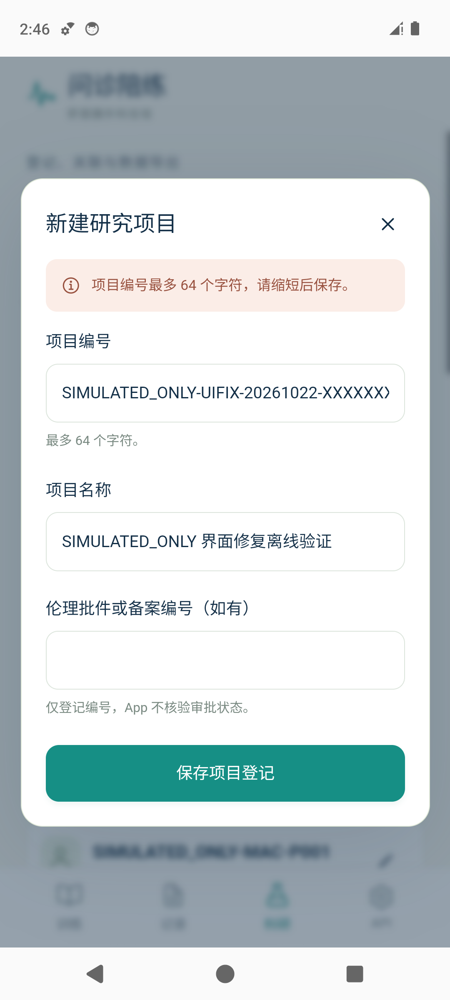
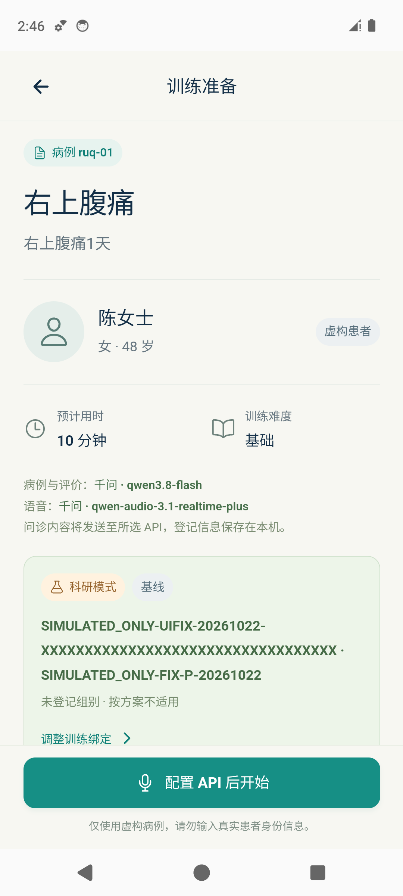
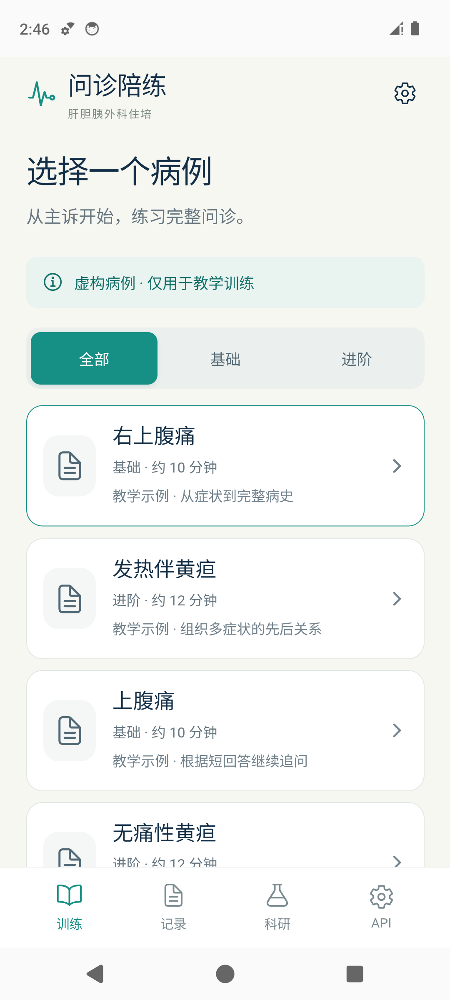

# v0.2.1 UI 修复与离线验证

日期：2026-10-22。App版本0.2.1/code3；公开预发布标签v0.2.1-alpha.1。
测试仅使用专用Android 14模拟器、WebView 113及虚构SIMULATED_ONLY登记。

## 三项修复

| 问题 | 修复后的行为 | 实际核对 |
| --- | --- | --- |
| 项目编号输入80、存储只允许64，失败显示原始英文JSON | 表单直接复用存储schema；编号64、年级50等限制一致；提交前显示中文字段提示，不截断原值 | 键盘输入第65字符受限；程序绕过DOM限制后显示中文提示；64字符可原样保存 |
| 下次训练科研绑定重启后回到练习 | 在本机私有文档中保存mode/phase/项目UUID/学员UUID；写入完成后才显示成功 | 强制结束进程、重开后，原项目/学员及baseline恢复；病例准备卡片一致 |
| 病例准备页系统返回键退出App | AndroidX返回回调接入当前页面；详情返回、弹窗优先关闭；训练首页可退后台 | 真实ADB系统Back由病例页回列表，Activity仍在前台；弹窗关闭后科研页保留；首页退后台可重开 |

偏好读取损坏、项目/学员缺失或跨项目时，显示警告并要求重新设置用途后才可开始；收起警告不会绕过确认。绑定保存期间阻断开训，保存失败不显示成功。登记读取失败后仍可刷新重试。

偏好仅属于当前设备的“下次训练”设置，不进入科研JSON备份，不改变已开始会话的冻结快照，也不恢复或导出API Key。

## 验证结果

- 根与mobile TypeScript检查通过；94项Node离线测试通过（原74项加20项本次回归）。
- Android debug构建通过；16项包检查、当前Web资源和9份第三方许可证核对通过；签名证书与原交付一致。
- 专用模拟器9项UI检查全部通过，包含损坏绑定阻断、进程重启、系统Back与弹窗处理。
- 原有1个合成会话的文件及冻结快照、原项目/学员登记哈希保持一致。
- 模拟器Wi-Fi及移动数据关闭，测试额外拦截原生模型传输；模型调用尝试0、外部Web请求0、页面错误0。

已测试APK SHA-256：`5eab491e864c49c4bba8eafa3cb8c3c8f1f6a22f847bd2afdb54c5e6542682b4`。

## 模拟器截图

| 中文字段提示 | 重启后的科研绑定 | 系统返回后的病例列表 |
| --- | --- | --- |
|  |  |  |

[损坏绑定的确认提示](images/ui-fixes/04-invalid-binding-requires-confirmation.png)。这些截图均来自实际安装的新APK与虚构登记。

## 可复现检查

安装对应debug APK到**专用模拟器**后，使用可选Playwright工具运行：

```bash
HPB_ANDROID_SERIAL=emulator-PORT \
HPB_UI_QA_DIR=/new/qa/output-directory \
node scripts/verify-ui-fixes.cjs
```

输出目录须不存在、父目录须已存在。设置ANDROID_HOME或HPB_ADB；若Playwright不在标准工具目录，使用PLAYWRIGHT_MODULE指定其模块目录。需支持`connectOverCDP`的`noDefaults`选项。
脚本会关闭该专用模拟器网络，创建有SIMULATED_ONLY前缀的登记，强制结束并重开测试App；不清数据、不读Key、不访问真实手机、不调用模型。它会暂写损坏的偏好以检查恢复门控，再通过UI恢复本次虚构绑定；不要在个人或真实研究设备上运行。

早期自动化尝试遇到WebView不支持Playwright默认Browser context设置，未进入业务检查；适配为`noDefaults`后9项通过。失败日志留在本地，未用旧截图代替当前结果。

## 仍待验收

本次只修复上述UI问题。自动给分偏高/跨轮次漏评未修；正式评分效度、教学效果、物理手机声学、蓝牙、后台/来电和院内网络均未由本轮建立。系统返回手势的动画和预测返回体验未单独测试。项目/学员写入成功但随后列表刷新失败的提示仍可改进，不能称界面已经全面完善。
